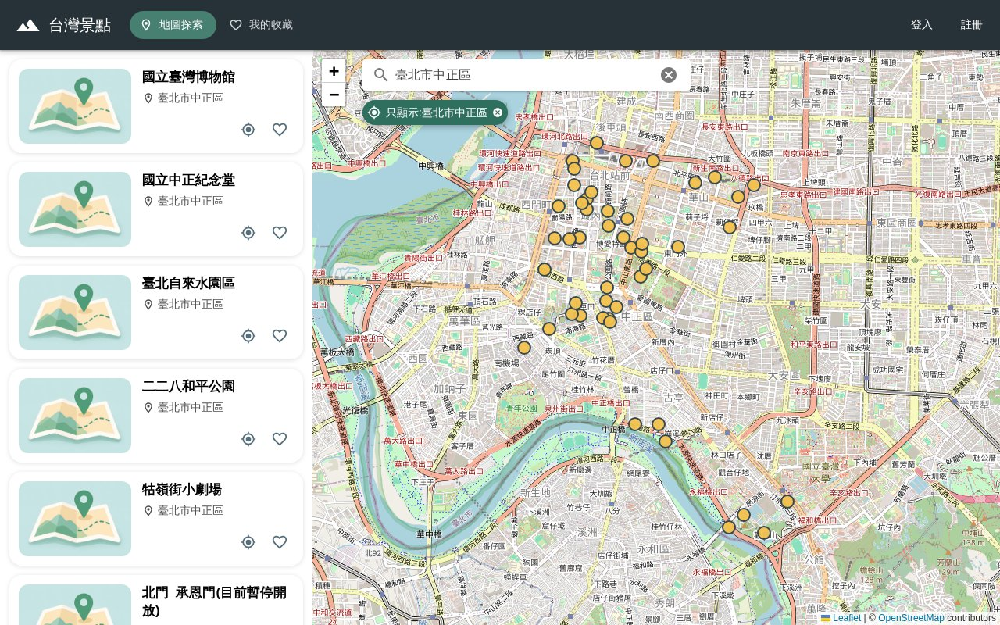
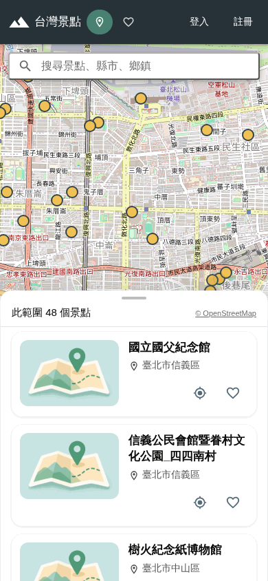
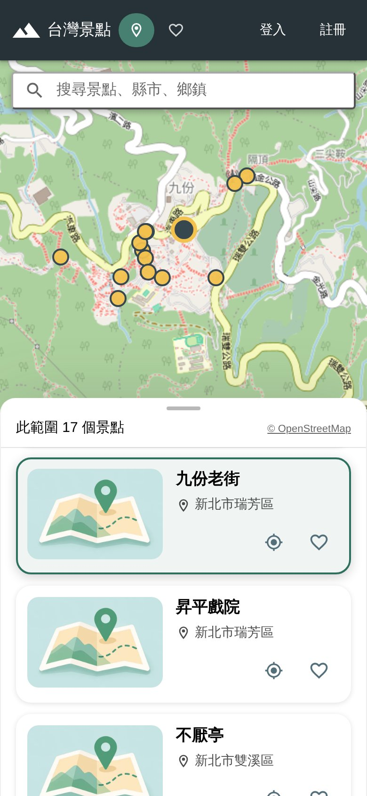
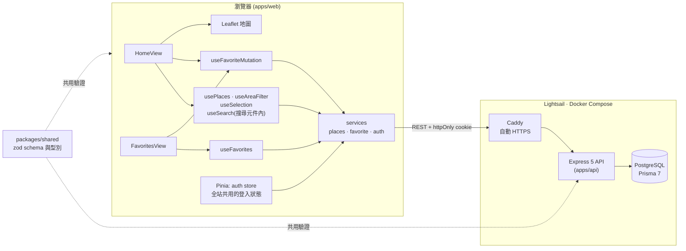

# 台灣景點地圖

在地圖上瀏覽、搜尋台灣景點,並收藏喜歡的地點。

**線上展示:** https://54-66-110-220.sslip.io

**示範帳號:** `demo@mail.com` / `demo1234`

<p align="center">
  
</p>
<p align="center">
  
  &nbsp;&nbsp;
  
</p>

## 功能

- **地圖與列表連動**:拖動、縮放地圖會重新查詢範圍內的景點;點地圖上的標記,列表捲到對應的卡片;卡片上的按鈕可以讓地圖飛到該景點
- **搜尋**:可以搜景點名稱、縣市、鄉鎮,例如「日月潭」、「台北市中正區」。「台」「臺」通用;縣市和鄉鎮連在一起或用空白隔開都可以;同名的鄉鎮(臺北市與基隆市都有中正區)會分開列出
- **地區篩選**:選了某個縣市或鄉鎮後,列表只顯示該地區的景點,地圖上有標籤標示目前的篩選,點標籤回到該區,按 × 取消
- **收藏**:樂觀更新(先更新畫面,失敗再還原並提示);沒登入時按愛心會導去登入,登入後自動完成剛才的收藏
- **登入系統**:Email 註冊/登入,登出或登入逾期會自動離開需要登入的頁面
- **響應式**:960px 以下地圖在上、景點放在可拖曳的 bottom sheet(收起/半開/全開);觸控裝置的搜尋是全螢幕頁面,避免鍵盤擋住下拉選單

## 架構



## 技術

|      |                                                                                                            |
| ---- | ---------------------------------------------------------------------------------------------------------- |
| 前端 | Vue 3、Vuetify 4、Pinia、Vue Router、Leaflet(OpenStreetMap)、Vite                                          |
| 後端 | Express 5、Prisma 7、PostgreSQL                                                                            |
| 共用 | `@travel/shared`:zod schema 與型別,前後端共用同一份驗證規則                                                |
| 驗證 | JWT access token 放在 httpOnly cookie;refresh token 雜湊後存資料庫、每次使用就換新(rotation);密碼用 bcrypt |
| 測試 | Vitest(前後端)、supertest(API 整合測試,使用獨立的測試資料庫)                                               |
| 部署 | Docker Compose、Caddy(自動 HTTPS)、AWS Lightsail、GitHub Actions                                           |
| 工具 | pnpm workspace、TypeScript、ESLint、Prettier                                                               |

## 設計重點

- **列表永遠跟著地圖範圍**:前端把地圖的畫面範圍送給後端查詢。後端限制單次查詢的範圍(0.5 度)與筆數(500 筆);前端依地圖容器的大小算出最小縮放等級,讓使用者縮不到會出錯的範圍
- **地區篩選在後端做**:如果只在前端篩,只能篩「已經載入的 500 筆」,會漏掉其他的。後端 `GET /api/places` 接受選填的 `city`、`town`(`town` 必須搭配 `city`,因為鄉鎮名稱會重複),`total` 與筆數上限也只計算符合的景點
- **畫面範圍和地區篩選是兩個狀態**:地圖每次拖動都會整個換掉畫面範圍,所以篩選不能存在裡面,兩者各自獨立,再用 `computed` 組合成查詢條件
- **搜尋結果不混進列表**:搜尋下拉只是「發射台」,選了才讓地圖移動或套用篩選,列表依然只由畫面範圍(加上篩選)決定
- **請求取消**:連續移動地圖或輸入搜尋時,舊的請求會被取消,不會被慢回來的舊結果蓋掉
- **前後端共用驗證**:API 的查詢參數用 zod 驗證,同一份 schema 也產生前端用的型別

## 測試與 CI/CD

```bash
pnpm --filter web test    # 前端單元測試
pnpm --filter api test    # 後端 API 整合測試(需要 Docker 的資料庫)
```

- 每個 PR 會跑 `check`:型別檢查、lint、格式、前後端測試、前端建置。測試使用獨立的資料庫(`travel_app_test`),不會動到開發資料
- `main` 設有保護規則:一定要透過 PR,而且 `check` 通過才能合併
- 合併到 `main` 之後自動部署:GitHub Actions 透過 SSH 連到 Lightsail,更新程式碼並重建容器,最後打健康檢查網址確認服務正常,失敗就讓流程變紅。建置先完成才會替換舊容器,建置失敗時舊版繼續運作

## 資料

景點資料來自交通部觀光署的開放資料[「景點 - 觀光資訊資料庫」](https://data.gov.tw/dataset/7777)(下載檔:[Attraction-json.zip](https://media.taiwan.net.tw/XMLReleaseAll_public/v2.0/Zh_tw/Attraction-json.zip),依[政府資料開放授權條款第 1 版](https://data.gov.tw/license)使用),6,000 多筆,放在 `apps/api/data/attractions.json`,用 `pnpm --filter api db:seed` 匯入資料庫。地圖底圖是 [OpenStreetMap](https://www.openstreetmap.org/copyright)。

目前只使用名稱、簡介、位置、是否免費與官方網址;來源資料還有類別、圖片、開放時間等欄位,尚未匯入。

## 已知限制

- **地區的範圍不是行政區邊界**:資料裡沒有邊界,所以搜尋出的「地區」範圍是該地區所有景點座標的最小外框。景點偏在一側時外框也會偏
- **大縣市只能分塊瀏覽**:像臺東縣這樣的大縣市,外框超過後端的查詢範圍上限,地圖縮不到放得下整個縣,只能拖動分段查看;篩選本身是正確的
- **景點照片是通用圖**:來源資料的圖片尚未匯入,所有卡片使用同一張預設封面

## 專案結構

```
apps/web          Vue 前端
apps/api          Express API + Prisma
packages/shared   前後端共用的 zod schema 與型別
docs/screenshots  README 的截圖
```

正式環境由 Express 同時提供 API 和打包好的前端,前後端同一個網址,cookie 不需要處理跨站問題。

## 在本機執行

需要 Node.js 22、pnpm、Docker。

```bash
pnpm install

# 啟動資料庫(Docker)
pnpm db:up

# 設定後端環境變數,內容已經對應 docker-compose 的資料庫
cp apps/api/.env.example apps/api/.env

# 建立資料表、匯入景點資料
pnpm --filter api db:migrate
pnpm --filter api db:seed

# 分別開兩個終端機
pnpm --filter api dev    # http://localhost:3000
pnpm --filter web dev    # http://localhost:5173
```

## 參考專案

最初的構想來自 JavaScript Mastery 的教學影片[〈Build and Deploy a Google Maps Travel Companion Application | React.js〉](https://www.youtube.com/watch?v=UKdQjQX1Pko),一個結合 Google Maps 的旅遊應用。本專案從頭以 Vue 3 重新實作:地圖改用 Leaflet 與 OpenStreetMap,景點資料改用政府開放資料,並自行設計後端 API、登入驗證、搜尋與地區篩選、測試,以及 CI/CD 自動部署。

## 開發方式

開發過程使用 [Claude Code](https://claude.com/claude-code) 作為協作與學習工具,包含概念講解、程式碼審查、Docker 部署設定,以及用瀏覽器自動化驗證功能。
